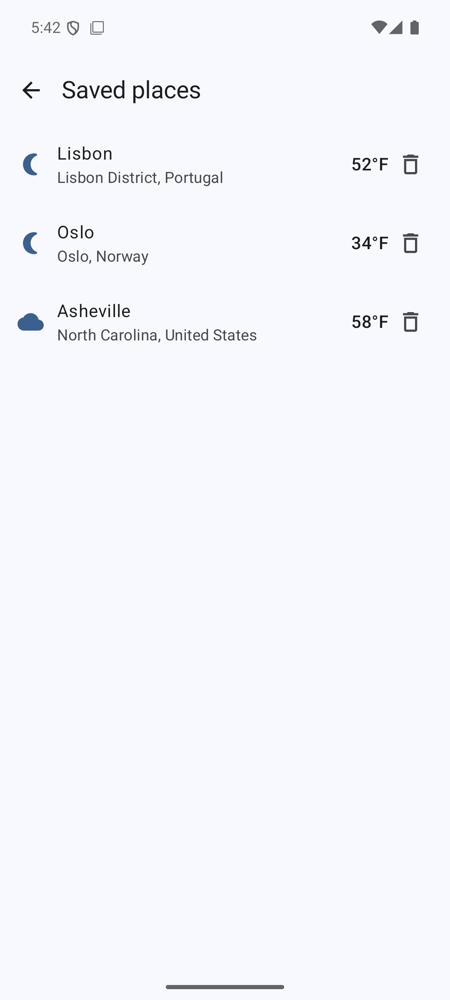
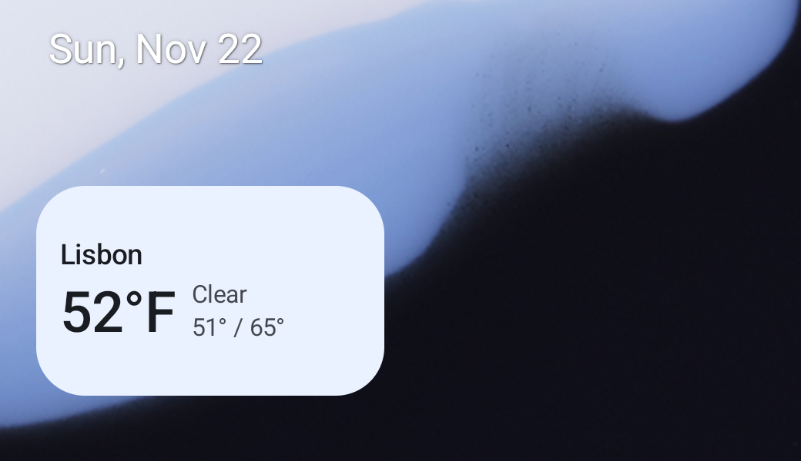

# android-weather

A weather app for Android in Kotlin and Jetpack Compose. A map with a
Material 3 search bar over it: search for a place, press and hold on the map,
or ask for where you are, and the forecast for the week appears. Places can be
saved, and their forecasts are kept on the device and refreshed in the
background, so the app opens on recent weather with or without a connection.

| Forecast                                                                                      | Saved places                                                                                   |
| --------------------------------------------------------------------------------------------- | ---------------------------------------------------------------------------------------------- |
|  |  |

It is the native build of an app also written in six cross-platform
frameworks:
[flutter-weather](https://github.com/calemccammon/flutter-weather),
[react-native-weather](https://github.com/calemccammon/react-native-weather),
[kmp-weather](https://github.com/calemccammon/kmp-weather),
[maui-weather](https://github.com/calemccammon/maui-weather),
[ionic-weather](https://github.com/calemccammon/ionic-weather) and
[capacitor-weather](https://github.com/calemccammon/capacitor-weather).
Those six stop at one screen that asks the network every time. This one goes
on to what a shipped Android app needs: a modular build, a database as the
source of truth, background work, runtime permissions, a widget,
notifications, and tests that run the whole app on a device.



## What it does

- **Search** with results as you type, after a short pause; an answer to an
  older search never replaces a newer one.
- **Pick a point** by pressing and holding on the map.
- **Where you are**: a button asks for approximate location at the moment it
  is pressed, not at launch. A refusal is answered with one line and a way to
  the app's settings.
- **Forecast**: current conditions, then seven days with the chance of
  precipitation and each day's range drawn against the week's.
- **Works offline**: every forecast fetched is kept. The app opens on the
  place it showed last, from the device, and says how old the forecast is.
  When a newer one cannot be fetched, the old one stays with word of why and a
  way to try again.
- **Saved places**: a bookmark keeps a place. The list shows each with the
  weather held for it; pull down to refresh them all, and removing one can be
  undone.
- **Background refresh**: every three hours, with a connection and battery to
  spare, the saved places' forecasts are fetched again. A screen that is open
  at the time changes by itself.
- **A home-screen widget** with the weather at the place the app shows. It
  is redrawn whenever that changes, and pressing it opens the app.
- **Severe weather alerts**: turned on from the saved places screen, which
  asks for the notification permission where Android requires it. After each
  background refresh, a thunderstorm, freezing rain or freezing drizzle
  forecast today or tomorrow at a saved place is told once, in a notification that opens the
  app on that place.
- **Celsius or Fahrenheit**, remembered between launches. Forecasts are kept
  in metric and converted on the device, so changing units fetches nothing.
- **Adapts to the window**: a draggable bottom sheet on a phone, a side panel
  from 840 dp wide.
- **Light and dark** themes from one seed colour, following the system; the
  map changes style with them. The launcher icon has a themed variant.
- **Accessible**: each forecast block is read as one sentence by a screen
  reader, what is loading or has failed is announced, and the forecast's
  columns grow with the device's text size.

## Modules

The build is split so that what a module may know is decided by what it
depends on, and checked by the compiler rather than by review.

| Module                              | Depends on                                              |
| ----------------------------------- | ------------------------------------------------------- |
| `core:model`, `core:designsystem`   | nothing                                                 |
| `core:domain`                       | `core:model`                                            |
| `core:network`, `core:datastore`    | `core:model`                                            |
| `core:database`                     | nothing                                                 |
| `core:data`                         | `core:domain`, `core:network`, `core:database`, `core:datastore` |
| `core:ui`                           | `core:model`, `core:designsystem`                       |
| `core:notifications`                | `core:domain`, `core:ui`                                |
| `feature:home`, `feature:places`    | `core:domain`, `core:model`, `core:ui`, `core:designsystem` |
| `widget`                            | `core:domain`, `core:ui`, `core:designsystem`           |
| `sync`                              | `core:domain`                                           |
| `app`                               | both features, `sync`, `widget`, `core:data`, `core:notifications`, `core:domain`, `core:model`, `core:designsystem` |
| `benchmark`                         | none; it starts `app` from outside                      |

Everything that draws or schedules depends on `core:domain` and never on
`core:data`: the implementations are known only to `app`, which hands them
over through Hilt.

| Module              | What it holds                                                                                                                                                                                                                                                  |
| ------------------- | -------------------------------------------------------------------------------------------------------------------------------------------------------------------------------------------------------------------------------------------------------------- |
| `core:model`        | The app's own types: `Place`, `Forecast`, `WeatherCondition`, `Units`, and the kinds of failure. Plain Kotlin, no Android.                                                                                                                                     |
| `core:domain`       | The repository interfaces and the use cases that hold the rules: when a forecast is fresh enough not to fetch again, what the background refresh does, which units apply. Plain Kotlin, no Android.                                                             |
| `core:network`      | Open-Meteo over Retrofit and OkHttp: the wire-shaped models, their translation into the app's types, and every way a request can fail turned into one of the app's own kinds of failure.                                                                                           |
| `core:database`     | Room: saved places and the forecasts last fetched. Each version of the schema is committed under `schemas/`.                                                                                                                                                   |
| `core:datastore`    | The settings file: units and the selected place, as JSON through DataStore. A file that cannot be read is started afresh.                                                                                                                                       |
| `core:data`         | The repository implementations, and the one Hilt module that says which stands behind each interface. `OfflineFirstForecastRepository` is the centre of it. Device location is here too.                                                                        |
| `core:designsystem` | The Material 3 theme and the design tokens.                                                                                                                                                                                                                    |
| `core:ui`           | Wording and icons for the app's types, and `UiText`, which lets a view model choose a string without holding a `Context`.                                                                                                                                       |
| `core:testing`      | Stand-ins for every repository, sample data and a clock that tests move by hand.                                                                                                                                                                                |
| `feature:home`      | The map, the search bar and the forecast, with their view models.                                                                                                                                                                                               |
| `feature:places`    | The saved places list and its view model.                                                                                                                                                                                                                       |
| `core:notifications`| The alert notifications and their channel.                                                                                                                                                                                                                     |
| `widget`            | The Glance widget, the state it shows and what keeps it drawn.                                                                                                                                                                                                  |
| `benchmark`         | The baseline profile generator and the startup benchmark, which start the release build from outside.                                                                                                                                                           |
| `sync`              | The WorkManager worker and its schedule.                                                                                                                                                                                                                        |
| `app`               | The application class, the activity and the navigation graph. The only module that sees both the screens and where their data comes from.                                                                                                                      |

A feature depends on the domain and the shared UI and nothing else, so it
cannot name Room, Retrofit or the other feature. The two screens are joined in
`app`'s `WeatherNavHost`: each says what it needs done, and neither knows the
other exists.

The view models read through use cases where there is a rule to apply
(which units, when to fetch again) and write straight to a repository where
there is none: a use case that only passes a call on is not written.

Each module's build file is a few lines, because what modules have in common
is in `build-logic`: convention plugins for an Android library, Compose, Hilt,
Room, a feature, a test module and a plain Kotlin library. They set the SDK levels, turn
compiler and Lint warnings into errors, and apply ktlint and detekt. Versions
are in `gradle/libs.versions.toml`.

## How data moves

The database is the one source of truth. Nothing fetched is handed to a
screen.

```
screen ◄── view model ◄── ObserveForecast ◄── Room (Flow)
                │                               ▲
                └── RefreshForecast ── Open-Meteo ┘ (written, never returned)
```

- `ForecastRepository.observe` only reads the database. `refresh` fetches and
  writes, and returns nothing; what it wrote reaches the screen through
  `observe`.
- So the home screen, the saved places list, the widget and the background
  worker cannot disagree, and none of them needs to be told when another has
  fetched.
- The view models keep nothing of their own to show. The selected place and
  the units are settings; the forecast is whatever the database holds. The
  screen is therefore the same after the process is killed.
- A forecast is fetched again once it is half an hour old: when its place is
  selected, each time the home screen comes back into view, and by the
  background refresh. A fetch for a place that is no longer selected is
  cancelled.
- A forecast is filed under its spot on the map, to a hundredth of a degree,
  so a town found by search and the same point picked off the map share one.
- Forecasts of places looked at in passing are deleted after a day; those of
  saved places are kept.

Each layer has its own model of the same thing:

|            | Network                        | Database                 | Model        | UI                                   |
| ---------- | ------------------------------ | ------------------------ | ------------ | ------------------------------------ |
| Type       | `ForecastDto`                  | `ForecastEntity`         | `Forecast`   | `ForecastUiModel`                    |
| A high     | `temperature_2m_max[1] = 17.9` | `high = 17.9`            | `high: 17.9` | `high`: "18°", `barEnd: 0.75`        |
| Conditions | `weather_code: 3`              | `condition = 'Overcast'` | `Overcast`   | an icon and "Overcast"               |
| A failure  | HTTP 400, a timeout            |                          | `Rejected`   | "The weather service refused the request." |

## Running

Kotlin 2.4, Android Gradle Plugin 9.1, Compose BOM 2026.11. Android 8.0
(API 26) and up. Gradle needs Java 21.

```sh
./gradlew :app:installDebug     # onto a running emulator or device
./gradlew :app:assembleRelease  # shrunk by R8, signed with the debug key
```

The location button needs Google Play services on the device.

## Checks

```sh
./gradlew ktlintCheck detekt lint                    # `./gradlew ktlintFormat` fixes formatting
./gradlew checkComposeStability -PcomposeReports     # no unstable field in a class the UI calls immutable
./gradlew test testDebugUnitTest                     # every JVM test
./gradlew verifyRoborazziDebug                       # the screens against their pictures
./gradlew :app:connectedDebugAndroidTest             # the whole app, on a connected device or emulator
```

**On the JVM**, 178 tests:

- **Model and domain**: plain unit tests of the rules, against the stand-ins
  in `core:testing`.
- **Network**: the Retrofit client against a local server that answers as
  Open-Meteo does, including each way a request fails.
- **Database and repositories**: a real SQLite database in memory, through
  Robolectric.
- **Settings**: DataStore over a real file, including one from a later version
  and one that is not JSON.
- **Background refresh, notifications, widget**: the worker run with
  WorkManager's test builder, notifications read back from the system's
  notification manager, the widget drawn with Glance's test harness.
- **View models**: on a test dispatcher, with the clock moved by hand.
- **Screens**: Compose UI tests of both whole screens, drawn by Robolectric
  with a stand-in for the map, at phone and wide sizes.
- **Screenshots**: eight pictures of the two screens, light and dark, kept in
  each feature's `src/test/snapshots` and compared by Roborazzi.
  `./gradlew recordRoborazziDebug` draws them again after an intended change.

**On a device**, six tests in `app/src/androidTest` run the real screens,
view models, Hilt graph, Room database, settings file and HTTP client. Two
things are swapped: a stand-in for Open-Meteo runs on the device, with one
small Hilt module pointing the app at it, and Hilt's test application stands
in for `WeatherApplication`. So what the application class does at launch
(scheduling the refresh, starting the widget's updater) is not run by any
test; the schedule and the worker are tested on their own.

- **Journeys**: search, select, drag the sheet up, save, find the place among
  the saved ones, remove it and undo; then reopen with the service down and
  find the forecast still there.
- **Scheduled refresh**: the worker Hilt builds, run by WorkManager's test
  driver as a periodic job with its constraints, checked for what it wrote to
  the database and for the notifications it raised.

Each device test runs in a fresh process with the app's data cleared.

**Compose stability.** The UI's models are marked `@Immutable`, which the
compiler takes on trust. `checkComposeStability` reads the compiler's own
report and fails if a class it treats as stable holds a field it calls
unstable, or one it can only judge when the app runs, such as a plain `List`.
So the models hold `ImmutableList`s, and the gaps in a string are a closed
set of types and not `Any`. Types from outside the app that are known not to
change are listed in `config/compose-stability.conf`.

**Startup.** `./gradlew :app:generateBaselineProfile` writes the baseline
profile, committed under `app/src/release/generated` because producing it
needs a device. `./gradlew :benchmark:connectedBenchmarkReleaseAndroidTest`
times a cold start with and without it (on an emulator, add
`-Pandroid.testInstrumentationRunnerArguments.androidx.benchmark.suppressErrors=EMULATOR`).
On the API 36 emulator the median of five cold starts was 475 ms with the
profile and 500 ms without, a difference inside the noise there; it has not
been measured on a phone.

`.github/workflows/ci.yml` runs the static checks, the JVM tests, the
screenshot comparison and the device tests (on an emulator) on pushes to
`main` and on pull requests, then builds the debug and release APKs and
uploads them.

## Data and credits

- Place search and forecasts: [Open-Meteo](https://open-meteo.com/) (no key;
  free for non-commercial use; CC BY 4.0).
- Map: [OpenFreeMap](https://openfreemap.org/) styles and tiles (no key),
  from [OpenMapTiles](https://openmaptiles.org/) and
  © [OpenStreetMap](https://www.openstreetmap.org/copyright) contributors,
  drawn with [MapLibre](https://maplibre.org/) through
  [MapLibre Compose](https://maplibre.org/maplibre-compose/).

## Known limits

- **English only.** Each module's wording is in its own `strings.xml`, so a
  second language is one more file per module; none has been written.
- **The map needs a connection.** Forecasts are kept on the device; map tiles
  are not, beyond what MapLibre caches by itself.
- **Search needs a connection.** Only forecasts and saved places are kept.
- **Location needs Google Play services**, and is approximate by design.
- **Alerts come from the forecast, not from a warning service.** Open-Meteo
  has no severe weather warnings, so an alert is a forecast of a thunderstorm,
  freezing rain or freezing drizzle. They are found when the background refresh runs, which
  Android may delay.
- **The widget shows one place**, the one the app shows, and has no picture
  for the conditions.
- **There is one version of the database**, so no migration has been written
  or tested yet.
- **The release build is signed with the debug key.** There is no release key
  in this repository.
