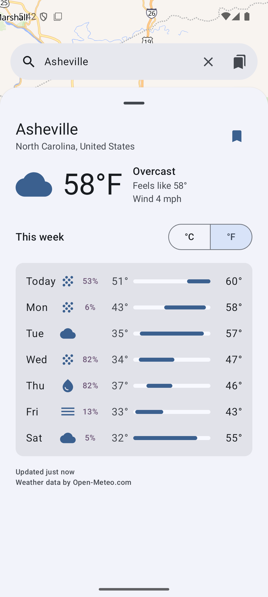

# android-weather

A weather app for Android in Kotlin and Jetpack Compose. A map with a
Material 3 search bar over it: search for a place, press and hold on the map,
or ask for where you are, and the forecast for the week appears. Places can be
saved, and their forecasts are kept on the device and refreshed in the
background, so the app opens on recent weather with or without a connection.

| Forecast                                                                                      | Saved places                                                                                   |
| --------------------------------------------------------------------------------------------- | ---------------------------------------------------------------------------------------------- |
|  |  |

It is the native build of an app also written in six cross-platform
frameworks:
[flutter-weather](https://github.com/calemccammon/flutter-weather),
[react-native-weather](https://github.com/calemccammon/react-native-weather),
[kmp-weather](https://github.com/calemccammon/kmp-weather),
[maui-weather](https://github.com/calemccammon/maui-weather),
[ionic-weather](https://github.com/calemccammon/ionic-weather) and
[capacitor-weather](https://github.com/calemccammon/capacitor-weather).
Those six stop at one screen that asks the network every time. This one goes
on to what a shipped Android app needs: a modular build, a database as the
source of truth, background work and a runtime permission.

## What it does

- **Search** with results as you type, after a short pause; an answer to an
  older search never replaces a newer one.
- **Pick a point** by pressing and holding on the map.
- **Where you are**: a button asks for approximate location at the moment it
  is pressed, not at launch. A refusal is answered with one line and a way to
  the app's settings.
- **Forecast**: current conditions, then seven days with the chance of
  precipitation and each day's range drawn against the week's.
- **Works offline**: every forecast fetched is kept. The app opens on the
  place it showed last, from the device, and says how old the forecast is.
  When a newer one cannot be fetched, the old one stays with word of why and a
  way to try again.
- **Saved places**: a bookmark keeps a place. The list shows each with the
  weather held for it; pull down to refresh them all, and removing one can be
  undone.
- **Background refresh**: every three hours, with a connection and battery to
  spare, the saved places' forecasts are fetched again. A screen that is open
  at the time changes by itself.
- **Celsius or Fahrenheit**, remembered between launches. Forecasts are kept
  in metric and converted on the device, so changing units fetches nothing.
- **Adapts to the window**: a draggable bottom sheet on a phone, a side panel
  from 840 dp wide.
- **Light and dark** themes from one seed colour, following the system; the
  map changes style with them. The launcher icon has a themed variant.
- **Accessible**: each forecast block is read as one sentence by a screen
  reader, what is loading or has failed is announced, and the forecast's
  columns grow with the device's text size.

## Modules

The build is split so that what a module may know is decided by what it
depends on, and checked by the compiler rather than by review.

```
app ─────────── feature:home ───┐
 │              feature:places ─┼── core:domain ── core:model
 │                              ├── core:ui ────── core:designsystem
 ├── sync ──────────────────────┘
 └── core:data ── core:network, core:database, core:datastore
```

| Module              | What it holds                                                                                                                                                                                                                                                  |
| ------------------- | -------------------------------------------------------------------------------------------------------------------------------------------------------------------------------------------------------------------------------------------------------------- |
| `core:model`        | The app's own types: `Place`, `Forecast`, `WeatherCondition`, `Units`, and the kinds of failure. Plain Kotlin, no Android.                                                                                                                                     |
| `core:domain`       | The repository interfaces and the use cases that hold the rules: when a forecast is fresh enough not to fetch again, what the background refresh does, which units apply. Plain Kotlin, no Android.                                                             |
| `core:network`      | Open-Meteo over Retrofit and OkHttp: the wire-shaped models, their translation into the app's types, and every way a request can fail turned into one of six kinds.                                                                                           |
| `core:database`     | Room: saved places and the forecasts last fetched. Each version of the schema is committed under `schemas/`.                                                                                                                                                   |
| `core:datastore`    | The settings file: units and the selected place, as JSON through DataStore. A file that cannot be read is started afresh.                                                                                                                                       |
| `core:data`         | The repository implementations, and the one Hilt module that says which stands behind each interface. `OfflineFirstForecastRepository` is the centre of it. Device location is here too.                                                                        |
| `core:designsystem` | The Material 3 theme and the design tokens.                                                                                                                                                                                                                    |
| `core:ui`           | Wording and icons for the app's types, and `UiText`, which lets a view model choose a string without holding a `Context`.                                                                                                                                       |
| `core:testing`      | Stand-ins for every repository, sample data and a clock that tests move by hand.                                                                                                                                                                                |
| `feature:home`      | The map, the search bar and the forecast, with their view models.                                                                                                                                                                                               |
| `feature:places`    | The saved places list and its view model.                                                                                                                                                                                                                       |
| `sync`              | The WorkManager worker and its schedule.                                                                                                                                                                                                                        |
| `app`               | The application class, the activity and the navigation graph. The only module that sees both the screens and where their data comes from.                                                                                                                      |

A feature depends on the domain and the shared UI and nothing else, so it
cannot name Room, Retrofit or the other feature. The two screens are joined in
`app`'s `WeatherNavHost`: each says what it needs done, and neither knows the
other exists.

Each module's build file is a few lines, because what modules have in common
is in `build-logic`: convention plugins for an Android library, Compose, Hilt,
Room, a feature and a plain Kotlin library. They set the SDK levels, turn
compiler and Lint warnings into errors, and apply ktlint and detekt. Versions
are in `gradle/libs.versions.toml`.

## How data moves

The database is the one source of truth. Nothing fetched is handed to a
screen.

```
screen ◄── view model ◄── ObserveForecast ◄── Room (Flow)
                │                               ▲
                └── RefreshForecast ── Open-Meteo ┘ (written, never returned)
```

- `ForecastRepository.observe` only reads the database. `refresh` fetches and
  writes, and returns nothing; what it wrote reaches the screen through
  `observe`.
- So the home screen, the saved places list and the background worker cannot
  disagree, and none of them needs to be told when another has fetched.
- The view models keep nothing of their own to show. The selected place and
  the units are settings; the forecast is whatever the database holds. The
  screen is therefore the same after the process is killed.
- A forecast is fetched again when it is half an hour old, or when asked for
  outright. A fetch for a place that is no longer selected is cancelled.
- A forecast is filed under its spot on the map, to a hundredth of a degree,
  so a town found by search and the same point picked off the map share one.
- Forecasts of places looked at in passing are deleted after a day; those of
  saved places are kept.

Each layer has its own model of the same thing:

|            | Network                        | Database                 | Model        | UI                                   |
| ---------- | ------------------------------ | ------------------------ | ------------ | ------------------------------------ |
| Type       | `ForecastDto`                  | `ForecastEntity`         | `Forecast`   | `ForecastUiModel`                    |
| A high     | `temperature_2m_max[1] = 17.9` | `high = 17.9`            | `high: 17.9` | `high`: "18°", `barEnd: 0.75`        |
| Conditions | `weather_code: 3`              | `condition = 'Overcast'` | `Overcast`   | an icon and "Overcast"               |
| A failure  | HTTP 400, a timeout            |                          | `Rejected`   | "The weather service refused the request." |

## Running

Kotlin 2.4, Android Gradle Plugin 9.1, Compose BOM 2026.11. Android 8.0
(API 26) and up. Gradle needs Java 21.

```sh
./gradlew :app:installDebug     # onto a running emulator or device
./gradlew :app:assembleRelease  # shrunk by R8, signed with the debug key
```

The location button needs Google Play services on the device.

## Checks

```sh
./gradlew ktlintCheck detekt lint   # `./gradlew ktlintFormat` fixes formatting
./gradlew test testDebugUnitTest    # every test
```

The tests run on the JVM, 138 of them:

- **Model and domain**: plain unit tests of the rules, against the stand-ins
  in `core:testing`.
- **Network**: the Retrofit client against a local server that answers as
  Open-Meteo does, including each way a request fails.
- **Database and repositories**: a real SQLite database in memory, through
  Robolectric.
- **Settings**: DataStore over a real file, including one from a later version
  and one that is not JSON.
- **Background refresh**: the worker built with stand-ins and run with
  WorkManager's test builder.
- **View models**: on a test dispatcher, with the clock moved by hand.
- **Screens**: Compose UI tests of both whole screens, drawn by Robolectric
  with a stand-in for the map, at phone and wide sizes.

`.github/workflows/ci.yml` runs all of these on pushes to `main` and on pull
requests, then builds the debug and release APKs and uploads them.

## Data and credits

- Place search and forecasts: [Open-Meteo](https://open-meteo.com/) (no key;
  free for non-commercial use; CC BY 4.0).
- Map: [OpenFreeMap](https://openfreemap.org/) styles and tiles (no key),
  from [OpenMapTiles](https://openmaptiles.org/) and
  © [OpenStreetMap](https://www.openstreetmap.org/copyright) contributors,
  drawn with [MapLibre](https://maplibre.org/) through
  [MapLibre Compose](https://maplibre.org/maplibre-compose/).

## Known limits

- **English only.** Each module's wording is in its own `strings.xml`, so a
  second language is one more file per module; none has been written.
- **The map needs a connection.** Forecasts are kept on the device; map tiles
  are not, beyond what MapLibre caches by itself.
- **Search needs a connection.** Only forecasts and saved places are kept.
- **Location needs Google Play services**, and is approximate by design.
- **There is one version of the database**, so no migration has been written
  or tested yet.
- **The release build is signed with the debug key.** There is no release key
  in this repository.
